<h3>Cybersecurity · System Administration · Web Development</h3>

## 👋 Hi, I'm Elang

I'm an IT student from Malang, Indonesia, focused on cybersecurity — mainly binary exploitation and web exploitation. I like digging into how systems fail: finding vulnerabilities, analyzing how programs behave under the hood, and turning that understanding into working exploits in CTFs. Alongside security, I manage Linux servers in my homelab and build web applications, which keeps me close to the systems I'm learning to break.

- 🛡️ Competing in CTFs, focused on pwn and web exploitation
- 🔍 Learning reverse engineering and binary analysis
- 🧪 Running a homelab with Linux, Docker, and self-hosted services
- 🌐 Building secure web systems for schools and communities
- 🎓 Sharing beginner-friendly Git, GitHub, and JavaScript material through METIC

## 🛠️ Tech Stack

**Security & Exploitation**

**Linux & Infrastructure**

**Web Development**

**Languages & Tools**

## 🚀 Featured Projects

<table>
<tr>
<td width="50%" valign="top">

### 🗳️ [E-Pilketos](https://github.com/Claritys11/web-pilketos)

A token-based e-voting system for the SMK Telkom Malang student council election, with one-time voter tokens, email delivery, a live results dashboard, and audit logs. Hardened with rate limiting, upload signature checks, and secure sessions, and self-hosted with Docker behind Cloudflare Tunnel.

`Next.js 16` · `Auth.js` · `Prisma` · `PostgreSQL` · `Docker`

 

[Live site](https://pilketos.clarityz.my.id/)

</td>
<td width="50%" valign="top">

### 🛡️ [DevSecOps Dashboard](https://github.com/Claritys11/DevSecOps-Dashboard)

A self-hosted monitoring dashboard for Linux hosts, Docker containers, endpoint and SSL checks, alerts, role-aware access, audit logs, and secure agent-based metrics ingestion.

`Next.js` · `Go` · `PostgreSQL` · `Docker` · `GitHub Actions`

</td>
</tr>
<tr>
<td width="50%" valign="top">

### 🏠 Homelab Deployment Platform

My self-hosted platform for running and deploying services, with Coolify and Docker managing apps, Traefik handling routing, and Cloudflare Tunnel publishing them to the internet.

`Coolify` · `Docker` · `Traefik` · `Cloudflare Tunnel` · `systemd-nspawn` · `CachyOS`

</td>
<td width="50%" valign="top">

### 🏝️ [Islet](https://github.com/Claritys11/islet)

An open-source Dynamic Island–style widget for Linux Wayland desktops, built with Quickshell and QML for niri and Hyprland.

`Quickshell` · `QML` · `Wayland` · `niri` · `Hyprland`

</td>
</tr>
<tr>
<td width="50%" valign="top">

### 🌐 Internext

A class hub for XI International at SMK Telkom Malang, with a member directory, project showcase, news, agenda, 360° gallery, live guestbook chat, and an admin CMS, deployed on Coolify.

`Next.js 16` · `Prisma` · `PostgreSQL` · `GSAP` · `Coolify`

 

[Live site](https://internext.web.id/)

</td>
<td width="50%" valign="top">

### 💻 [Elaang Portfolio](https://github.com/Claritys11/ElaangPortofolio)

A cyberpunk terminal-themed portfolio with CTF write-ups, projects, achievements, contact messages, SEO, uploads, and a private admin dashboard.

`Next.js 15` · `React 19` · `Prisma` · `PostgreSQL`

 

[Live site](https://claritys.web.id)

</td>
</tr>
<tr>
<td colspan="2" valign="top">

### 🔧 Current Focus

Sharpening binary and web exploitation through CTFs, getting comfortable with reverse engineering, and hardening the Linux servers and web apps I run.

`Pwn` · `Web Exploitation` · `Reversing` · `Linux`

</td>
</tr>
</table>

## 🏆 Selected Achievements

| Competition / Certification | Result |
|:--|:--|
| CYBREAK CTF 2026 — Informatics Dept., ITS | 🥉 3rd Place |
| Meta4Sec CTF 2026 | Finalist & Best Writeup Award |
| Jatim Cybersecurity Competition (JCC) 2025 — KOMINFO | Finalist — 17th |
| SCTF National 2026 — DCSC Darmajaya | Top 20 |
| CTF FGTE 0 2026 | Top 25 |
| HackAstra CTF Qualifiers 2026 | 69th / 455 teams |
| Junior Crypt CTF 2026 | 75th internationally |
| Certified Cybersecurity Educator Professional (CCEP) — Red Team Leaders | Certified (2026) |

More competitions and certificates are listed on my [portfolio](https://claritys.web.id/achievements).

## 🐍 Contribution Activity

 

<picture>
  <source media="(prefers-color-scheme: dark)" srcset="https://raw.githubusercontent.com/Claritys11/Claritys11/output/github-contribution-grid-snake-dark.svg" />
  <source media="(prefers-color-scheme: light)" srcset="https://raw.githubusercontent.com/Claritys11/Claritys11/output/github-contribution-grid-snake.svg" />
  
</picture>

If the animation is still being generated, [view my contribution calendar directly on GitHub](https://github.com/Claritys11).

## 🌱 Currently Learning

- Binary exploitation — memory corruption, ROP, and heap techniques
- Web exploitation and common web application vulnerabilities
- Reverse engineering and binary analysis
- Linux administration and server hardening
- Writing secure web applications from the ground up

## 🔗 Connect

Thanks for stopping by — always learning how things work, and how they break.

